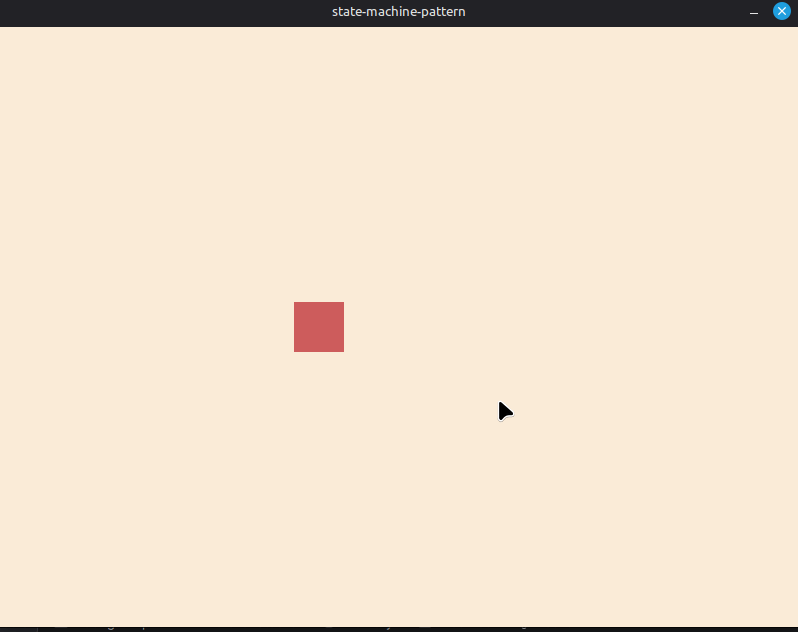

# state-machine-pattern
my study of the state machine pattern for games, using monogame for rendering and the main loop. 

this pattern primarily involves changing an object's behavior based on different conditions. it can be implemented using enums or dedicated classes for each state, among other approaches. it is highly useful because it encapsulates all behavioral logic in one specific place, making it easier to test, debug and implement changes.

in this example project, the player has three possible states (idle, walk or run). the player's update method always executes the update logic for the current state, and state transitions are managed by a StateMachine!!

# considerations
i really enjoyed using this pattern, though i found it somewhat challenging to keep the StateMachine generic, of course, the implementation always depends on the specific problem being solved. i believe this implementation would require the use of Generics, or perhaps copying states to other types of objects beyond just the player.

# references
https://gameprogrammingpatterns.com/state.html<br>
https://en.wikipedia.org/wiki/State_pattern<br>

# project



the game changes the player color for each state applied (idle, walk and run)!

# controls
<kbd> WASD </kbd> movement<br>
<kbd> shift </kbd> run

# how to run 
<sub>press shift haha</sub>
```bash
git clone https://github.com/katsudev22/state-machine-pattern.git
cd state-machine-pattern
dotnet run
```
<sub>*(make sure you have requirements for run monogame and dotnet!!)*</sub>
